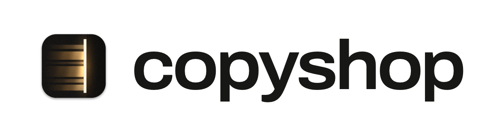
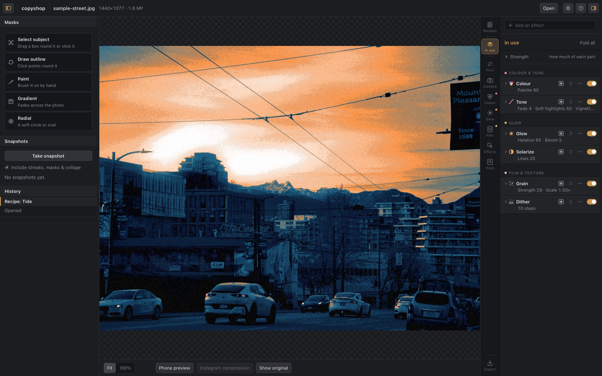

<p align="center">
  <picture>
    <source media="(prefers-color-scheme: dark)" srcset=".github/logo-dark.png">
    
  </picture>
</p>

<p align="center">
  <a href="https://getcopyshop.com">Website</a> |
  <a href="https://getcopyshop.com/download">Download</a> |
  <a href="https://getcopyshop.com/app/">Try it free</a> |
  <a href="https://getcopyshop.com/request">Request a feature</a>
</p>

<p align="center">
  <a href="https://github.com/IttsKK/copyshop/actions/workflows/ci.yml"></a>
  <a href="https://github.com/IttsKK/copyshop/releases/latest"></a>
  <a href="LICENSE"></a>
  <a href="CONTRIBUTING.md"></a>
</p>

A creative workshop for your photos. Streak a subject, lay a new sky into the
gaps between wires, repeat a building across the frame, and finish it with film
grain, dither, glow and a paper border. Each effect is a module you switch on,
adjust, and keep to part of the photo with a mask.



copyshop runs on macOS, Windows and Linux. Official builds are sold at
[getcopyshop.com](https://getcopyshop.com/buy) for a one-time price and update
themselves. There is also a free [browser playground](https://getcopyshop.com/app/)
with a few of the effects.

This repository is the full source of the desktop app. You can read it, change
it and build copyshop for your own use. See [License](#license).

## Building

You need [Node.js](https://nodejs.org) 20 or newer and
[Rust](https://www.rust-lang.org/tools/install).

On Linux, install the WebKit libraries Tauri needs first:

```sh
sudo apt install libwebkit2gtk-4.1-dev libappindicator3-dev librsvg2-dev patchelf
```

Then:

```sh
npm ci
npm run app:native     # run the app with hot reloading
npm run build:app      # build it into src-tauri/target/release/bundle
```

`npm run dev` runs the editor in a browser instead, at http://localhost:5178.

A build from this source asks for no license key. It never checks for updates
and sends no crash reports or usage data. Settings says it was built from
source, with a link to buy copyshop if it's useful to you.

## Tests

```sh
npm test               # unit tests (Vitest)
npx tsc -b             # type check
```

`selftest.html` (open it from `npm run dev`) checks the renderer in the browser:
blends, the preview matching the export, and the grain's statistics.

## Layout

| Folder | What's in it |
| --- | --- |
| `src/engine` | The renderer: WebGL shaders for every effect, and what places them on the photo. |
| `src/ui` | The interface: the module stack, the Library, panels and on-photo tools. |
| `src/storage` | Edits, recipes, presets and the library, on disk in the app and in the browser otherwise. |
| `src/ml` | Subject selection, with the EdgeTAM model in `public/models`. |
| `src/pipeline` | Opening and exporting photos. |
| `src-tauri` | The desktop app (Tauri). |
| `presets` | The built-in recipes. |

## Contributing

Bug reports and ideas are welcome in
[Issues](https://github.com/IttsKK/copyshop/issues), and fixes are welcome as
pull requests. See [CONTRIBUTING.md](CONTRIBUTING.md) for how it works.

## License

copyshop's source is public so you can see how it works, fix things, and build
it for yourself.

- The source code and official builds are distributed under the
  [copyshop License](LICENSE). In short: build it, change it, and use it for any
  work, commercial work included. Please don't share or sell builds; buying
  copyshop is what keeps it going.
- Parts made by others (the libraries it uses and the subject-selection model)
  keep their own licenses. See [THIRD_PARTY.md](THIRD_PARTY.md).
